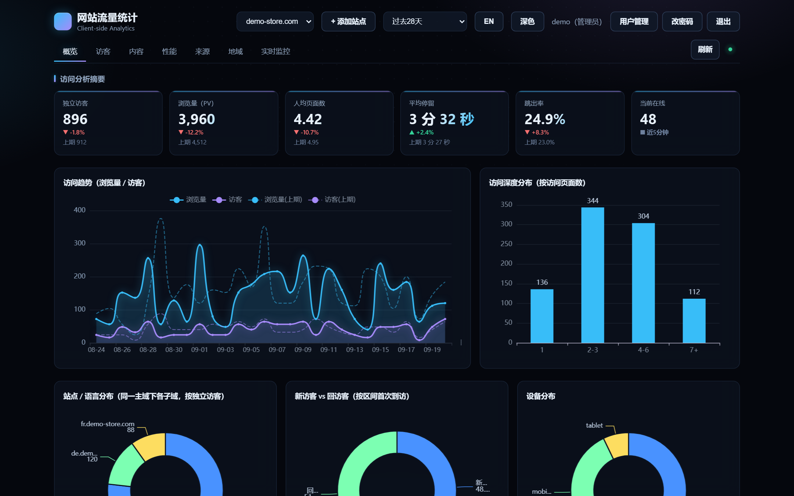
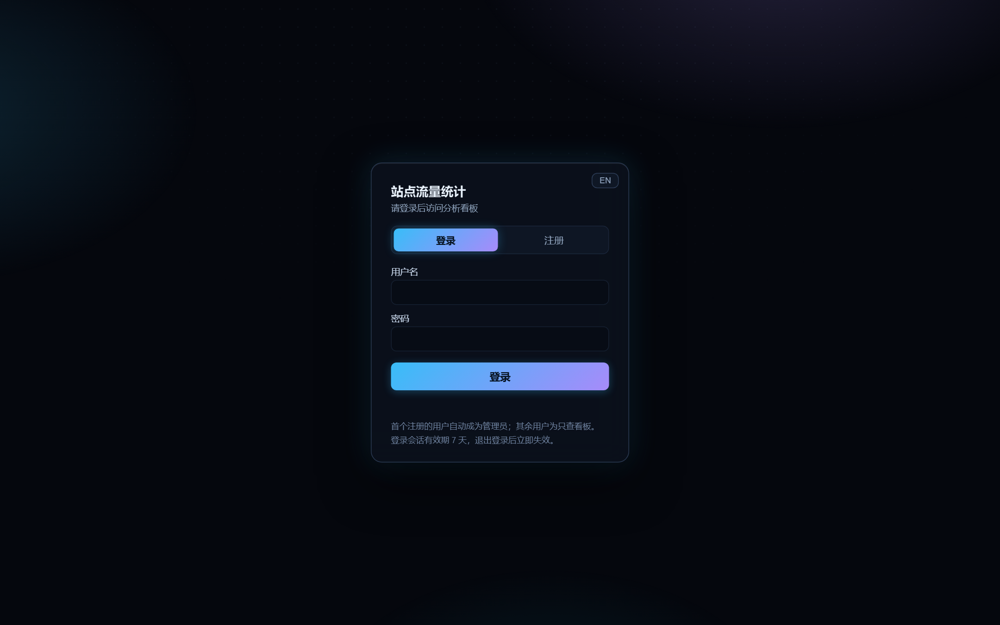
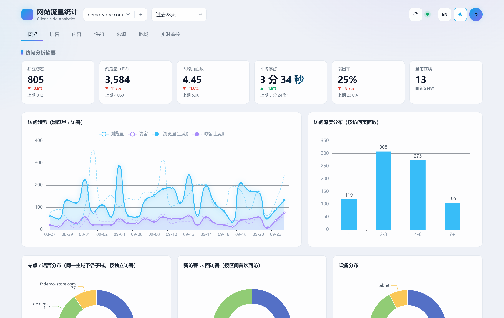

# Site Analytics

[](LICENSE)
[](https://www.python.org)
[]()
[]()

> 中文文档：[README.md](README.md)

A lightweight, self-hosted, privacy-friendly website analytics tool. **Based on front-end instrumentation — it does not depend on any access logs.**

By embedding a tiny JS snippet (`tracker.js`) into the pages you want to track, **real visitors' browsers** actively report visit events. Compared to parsing Nginx/Apache access logs, this approach naturally avoids machine-traffic noise such as crawlers, monitors, CDN origins, and health checks, delivering a higher signal-to-noise ratio and metrics logs cannot provide (true time-on-site, bounce rate, SPA routing, normalized device/browser dimensions, etc.).

- **Zero required third-party dependencies**: The back end runs using only the Python standard library (`http.server`); charts use a local ECharts build — no network needed, no database service required.
- **Self-hosted**: Data lives in a SQLite file on your own server and never passes through any third party.
- **Optional enhancement**: GeoIP geographic distribution (`maxminddb` + GeoLite2, freely optional — auto-disabled when missing, without affecting other features).

---

## Features

- **Real-visitor metrics**: PV, unique visitors (UV), sessions, bounce rate, average time on site, pages per visitor.
- **Dimension analysis**: Top pages, referrer domains, device distribution, browser distribution, OS distribution, screen resolution.
- **Real-time monitoring**: Recent visitor flow, dashboard polls and refreshes every 5 seconds.
- **Visitor geography (optional)**: Country / region distribution + city TOP, with flags; can also identify ISP/operator (ASN).
- **Time ranges**: Last 1 day / 7 days / 30 days, aggregated by day.
- **Site management**: Manually add sites from the panel; auto-generates the instrumentation snippet that already includes the per-site deploy token, one-click copy; supports deregistering (preserves already-collected events).
- **SQLite event storage**, aggregated queries by day, single file easy to back up.
- **Public reporting endpoint** (`/api/event`, CORS open); dashboard and query APIs are protected by **account login (v1.5.0+, admin / viewer roles)**.
- **Anti-fraud**: Automatically filters `navigator.webdriver` and known crawler UAs.
- **Reverse-proxy friendly**: Restores the real visitor IP via `X-Forwarded-For` / `X-Real-IP`.

---

## Dashboard Tour (Feature Modules)

The analytics dashboard (`index.html`) is a single-page console. The top bar lets you switch **Chinese / EN** language, toggle dark / light theme, and manually refresh. It contains the following modules:

| Module | Content |
|--------|---------|
| Overview | Core KPIs: PV / UV / sessions / bounce rate / avg. time on site, visit trend, visit depth, new vs. returning visitors, device distribution |
| Visitors | Visitor details (source, device/browser, ISP, region, time on site, last active), potential target visitors and suspected bot / data-collection flags |
| Content | Top pages, top landing pages, top exit pages, top pages by avg. time on site |
| Performance | Front-end performance samples (FCP / LCP / TTFB / CLS / Speed Index) |
| Sources | Source-type distribution, top source domains |
| Geography | World map + country/region ranking + city TOP (requires GeoIP enabled) |
| Real-time | Visitor flow for last 5 / 10 / 30 minutes, polls every 5 seconds |
| Site Management | Add/remove sites, generate snippet, set data-retention period, manage blocked visitors |




| Login (dark glassmorphism) | Overview (light theme, one-click toggle) |
|---|---|
|  |  |

---

## How It Works

```
 Visitor browser             Your server                      Data
┌─────────────┐   load/report  ┌──────────────────┐        ┌──────────┐
│ Tracked page │ ────────────▶ │  tracker.js       │        │          │
│ (any site)   │ ◀──────────── │  app.py (8899)    │ ─────▶ │ SQLite   │
└─────────────┘   return script│  event collect+agg│  write  │ events.db│
                              │  + dashboard html  │        │          │
                              └──────────────────┘        └──────────┘
                                     ▲
                              dashboard browser (view charts)
```

1. You embed `tracker.js` (one `<script>`) into every page of the target site.
2. When a visitor opens a page, the browser loads `tracker.js` and reports the visit to `/api/event` (time on site is reported when the page is hidden).
3. `app.py` receives the event and writes it to `data/events.db`, grouped by site (`data-site`).
4. You view the aggregated charts via the dashboard (`index.html`); the dashboard and the reporting endpoint can sit behind a reverse proxy.

> **Why not parse logs?** Logs are filled with non-human traffic (crawlers, monitors, CDN origins, health checks) and cannot capture client-side behavior such as time on site or bounce rate. Front-end instrumentation counts only real browser executions — cleaner and more accurate.

---

## Directory Structure

```
site_analytics/
├── app.py                  # Back end: event collection + aggregation + dashboard + tracker.js (single file)
├── tracker.js              # Front-end instrumentation script (embed into tracked pages)
├── index.html              # Analytics dashboard HTML shell (styles & scripts split into static/ since v1.6.0)
├── tracker-loader.html     # Optional "inline loader" snippet (for sites with heavy cache/optimization plugins)
├── nginx_bypass_auth.conf  # Two-location reverse-proxy config example (generic Nginx)
├── static/
│   ├── echarts.min.js      # Local chart library (bundled, no network needed)
│   ├── style.css           # Dashboard styles (split from index.html in v1.6.0)
│   ├── i18n.js             # Dashboard i18n dictionary & translation helpers (zh/EN, shared with login page)
│   ├── iso3166.json        # Country/region code lookup table
│   ├── world_map.json      # ECharts world map GeoJSON (coordinates kept at 2 decimals)
│   └── app.js              # Dashboard app logic (split from index.html in v1.6.0)
├── start.sh                # Start script (runs in background, writes run.log)
├── restart.sh              # Restart script
├── sa-console.sh           # Server management console: start/stop/restart/version-check-upgrade/one-click rollback
├── site_analytics.service  # systemd unit example
├── update_geoip.sh         # Download / update GeoLite2 databases (City + ASN)
├── tests/                  # Regression test scripts (10 stdlib / bash scripts; run from repo root with python tests/test_xxx.py)
├── geoip/                  # Runtime location for GeoLite2-*.mmdb (download yourself, not in repo)
└── data/                   # Generated at runtime: events.db + run.log / debug.log
```

> The `.mmdb` databases under `geoip/` are ~130MB and excluded via `.gitignore` (not in the repo). After cloning, fetch them with `update_geoip.sh`.

> **Static asset cleanup (this batch)**: the front end always loads `static/world_map.json`. `static/world.json` was removed (1,010,239 B, zero references repo-wide, geometrically duplicate of `world_map.json`); `static/world_map.json` coordinate precision was reduced to **2 decimal places** (1,069,687 B → 462,979 B; 217 features / Polygon 126 / MultiPolygon 91 all unchanged). Precision **must not** be reduced to 1 decimal place — testing showed it produces many degenerate edges and collapsed rings. The self-update manifest covers runtime files only, not docs — see "Upgrade Integrity Verification".

> **Regression scripts (this batch)**: a new `tests/` directory holds 10 pure-stdlib / bash regression scripts; run them from the repo root with `python tests/test_xxx.py`, and each script locates `app.py` automatically. `tests/` is not in `sha256sums.txt` (which lists only 18 runtime files), but tag tarballs still contain it; accordingly `sa-console.sh` allow-lists only top-level `.py` scripts under `tests/` (pattern `tests/[A-Za-z0-9_.-]+\.py`) and excludes `tests` during overlay installs, so test scripts are not written into the production directory.

---

## Requirements

| Component | Requirement | Notes |
|-----------|-------------|-------|
| Python | **3.7+** (3.10+ recommended) | Core features run on the standard library only |
| Third-party libs | **None (core)** | No `pip install` needed |
| `maxminddb` | Optional | Only needed when enabling GeoIP: `pip install maxminddb` |
| Web server | Optional (recommended for prod) | Any of Nginx / Caddy / Apache, for reverse proxy + HTTPS |
| OS | Linux / macOS / Windows | Self-hosting is mostly on Linux servers |

> This project does **not** depend on Node.js, an external database (MySQL/PostgreSQL, etc.), or any cloud service.

---

## Quick Start

```bash
# 1. Get the code
git clone https://github.com/gg4midas/site_analytics.git
cd site_analytics

# If GitHub is slow in your region, use the Gitee mirror (synced with GitHub):
git clone https://gitee.com/operations-go_0/site_analytics.git

# 2. Start (listens on 127.0.0.1:8899 by default, no third-party libs)
python3 app.py

# 3. Create the admin account (self-registration is off by default — this is the only bootstrap path)
python3 app.py --create-admin admin YOUR_PASSWORD

# 4. Open the dashboard in a browser
#    http://localhost:8899/    (unauthenticated visits redirect to the /login page)
```

After the dashboard starts, embed the snippet (see "Embed the Snippet" below) into the site you want to track; data will appear automatically once visitors arrive.

> To customize the port / listen address / data directory, see "Configuration"; for accounts and permissions see "Users & Permissions".

---

## Configuration

Startup flags are passed on the command line; a few runtime behaviors are tuned via environment variables — there is no config file:

| Parameter | Default | Notes |
|-----------|---------|-------|
| `--host` | `127.0.0.1` | Listen address. In production keep `127.0.0.1` and expose via reverse proxy; set `0.0.0.0` to expose publicly (not recommended). |
| `--port` | `8899` | Listen port. |
| `--create-admin USER PASSWORD` | none | Create an admin account and exit (headless bootstrap). **This is the only way to create the first account** (self-registration is off by default); handy for systemd / scripted deployments. |
| `--data-dir` | `./data` | Data storage directory (holds `events.db`, logs). Can point to another disk/mount. |
| `--geoip-db` | `./geoip/GeoLite2-City.mmdb` | GeoIP city database path. Geographic features auto-disable if the file is absent. |
| `--asn-db` | `./geoip/GeoLite2-ASN.mmdb` | GeoIP ASN database path, used to identify the visitor's ISP. |
| `SA_EVENT_RATE_LIMIT` (env var) | `600` | `/api/event` rate limit: number of events a single client IP may report within one window; exceeding it returns `429`. |
| `SA_EVENT_RATE_WINDOW` (env var) | `60` (seconds) | Length of the rate-limit window in seconds; together with `SA_EVENT_RATE_LIMIT`, counted globally per client IP. |

Examples:

```bash
# Localhost only, custom port (most common with a reverse proxy; dashboard uses account login)
python3 app.py --host 127.0.0.1 --port 8899

# Scripted deployment: pre-create an admin account (the process exits right after)
python3 app.py --create-admin admin YOUR_PASSWORD

# Store data on a separate mount and enable the geo database
python3 app.py --data-dir /var/lib/site_analytics --geoip-db /opt/geo/GeoLite2-City.mmdb
```

> **`--token` is deprecated**: since v1.5.0 the dashboard uses account login; the flag is kept but ignored (old systemd units keep working). The old `?token=xxx` access method no longer works — register / log in to use the dashboard.

## Users & Permissions

Since v1.5.0 the dashboard ships built-in account login, which **fully replaces the old `?token=` access token**: unauthenticated visits to the dashboard redirect to the `/login` page, and every query API returns 401.

### Registration & Login

**Self-registration is off by default** (since v1.8.6). The login page does not render a "Register" tab, and `POST /api/register` returns 403.

- **First use (the only bootstrap path)**: `python3 app.py --create-admin USER PASSWORD` creates an admin headlessly and exits.
- To add more people afterwards: sign in as admin → avatar menu → "Users & Permissions" → create an account with a role.
- The session lives in an HttpOnly cookie, valid for 7 days. After expiry or clicking "Log out" in the top bar you must sign in again.

> **Why registration is not open by default**: once the user table is non-empty, a new registrant gets the `viewer` role, and `viewer` can read `/api/stats`, `/api/visitors`, `/api/admin/blocked` and `/api/admin/settings` — i.e. **every visitor record and all geo data**. On an internet-reachable instance, open registration means "anyone who types a username and password can read your traffic".

#### Optional: enable self-registration (approval required)

If you really want people to apply for accounts themselves, turn it on with an env var:

```bash
SA_ALLOW_REGISTER=1 python3 app.py          # or add Environment= to the systemd unit
```

Behaviour once enabled:

| Scenario | Result |
|----------|--------|
| First registrant while the user table is **empty** | Becomes `admin` and is signed in directly (bootstrap). **Create the admin via `--create-admin` before enabling**, otherwise whoever registers first becomes the admin — the server prints a warning on startup for this combination |
| Registration once users exist | Created as `viewer` with `status='disabled'` (**pending**): no session issued, cannot sign in, can read nothing; the response is `{"status": true, "pending": true}` |
| Approval | Click "Enable" under Users & Permissions (`POST /api/admin/user`, `action=status&status=active`) |

Startup logs report the current state (`自助注册：已关闭` = disabled, `自助注册：已开启` = enabled with approval required).

### Roles

| Role | Permissions |
|------|-------------|
| `admin` | Everything: add/remove sites, per-site deploy tokens, retention / cleanup-now, visitor blocking & restore, stats timezone, user management (create / change role / disable / reset password / delete) |
| `viewer` | Read-only: see the full analytics dashboard and data, cannot change anything |

- At least one admin always exists: the last admin cannot be demoted / disabled / deleted.
- Login and registration are rate-limited per IP (10 attempts / 5 minutes); passwords are stored with PBKDF2-SHA256 (100k iterations + per-user random salt); session tokens are 48-char random hex values.
- Signed-in users can change their own password via "Change Password" in the top bar (requires the current password).

### Public endpoints

Only the following require no login: `/api/event` (event reporting), `/tracker.js`, `/static/*` assets, the `/login` page and the login / session-info APIs. `/api/register` is disabled by default (returns 403) and only works when `SA_ALLOW_REGISTER=1` is set. Everything else requires login; admin-only APIs additionally require the admin role.

> `/api/event` is now rate-limited per client IP: requests over the quota return `429` (body `{"status": false, "error": "上报过于频繁，请稍后再试"}` — "reporting too frequent, try again later"), but still carry `Access-Control-Allow-Origin: *`, so browser instrumentation is unaffected. See "/api/event rate limiting".

---

## Security Hardening (v1.8.7)

The following describes the v1.8.7 batch of application-layer and ops hardening changes, covering global security response headers, the session cookie's `Secure` condition, the default-compatible CSRF mode, and the back-end stats cache adjustment.

### Application-Layer Security Response Headers

All HTTP responses get the headers appended at a single choke point — `Handler.end_headers()` in `app.py`. This is the only injection point and covers every response type (including gzip compression, ETag `304`, `204`, `302`, `404`, `HEAD`) without breaking `Content-Length`:

| Header | Value |
|--------|-------|
| `X-Content-Type-Options` | `nosniff` |
| `Referrer-Policy` | `strict-origin-when-cross-origin` |
| `X-Frame-Options` | `SAMEORIGIN` |
| `Content-Security-Policy` | `default-src 'self'; script-src 'self' 'unsafe-inline'; style-src 'self' 'unsafe-inline'; img-src 'self' data:; connect-src 'self'; object-src 'none'; base-uri 'self'; form-action 'self'; frame-ancestors 'self'` |

> **Why CSP keeps `'unsafe-inline'`**: the login page is server-rendered inline `<script>` / `<style>`; `index.html` has 33 HTML `on*` event attributes; and the HTML dynamically assembled in `static/app.js` contains 20+ more `on*` handlers. Removing `'unsafe-inline'` would directly break dashboard rendering and interaction, so it is kept as-is — not a temporary leftover.

### Session Cookie `Secure` Condition

The session cookie is still named `sid`. `; Secure` is appended only when either condition holds: a trusted reverse proxy forwards `X-Forwarded-Proto: https`, or `SA_SECURE_COOKIE=1` is explicitly set. A local plain-HTTP direct connection (development / intranet deployment) does not carry `Secure`, avoiding a regression where the login session cannot be written back over plaintext HTTP. The existing `HttpOnly`, `Path=/`, and `Max-Age` are unchanged.

### CSRF Protection (default-compatible mode)

Management-type write requests (`POST` / `DELETE`) are checked by origin:

- Missing `Origin` / `Referer` → **allowed** (compatibility with older clients, `curl`, non-browser callers).
- An explicitly cross-site `Origin` → `403`.
- Setting `SA_CSRF_STRICT=1` switches to strict mode: requests missing the origin headers are then rejected too.

Exempt paths: `/api/event`, `/api/login`, `/api/register`, `/api/logout`. Among them, `/api/event` must remain open to anonymous cross-origin reporting from any `Origin` and return `Access-Control-Allow-Origin: *` (required for browser instrumentation) — it is **not** under CSRF protection.

### Stats Cache and Manual Refresh (back end)

- The back-end stats cache `STATS_CACHE_TTL` was changed from 45 seconds to **90 seconds**. This is the **back-end stats API cache**, not the front-end poll / refresh interval; the front-end auto-refresh timers (15s / 30s / 60s) are unchanged in this batch.
- `GET /api/stats?fresh=1` bypasses the read cache and re-aggregates, but **still writes back to the same cache key**, and is rate-limited by `_fresh_rate_ok()` (at most 3 times per 10 seconds) to avoid frequent cache penetration.
- The stats JSON response now carries `Cache-Control: no-store`.

---

## New in This Batch: Event Rate Limiting and Stats-Query Performance

### /api/event rate limiting

`/api/event` is now rate-limited by a **global per-client-IP counter**, controlled by two new environment variables:

- `SA_EVENT_RATE_LIMIT` (default `600`): number of events a single client IP may report within one window.
- `SA_EVENT_RATE_WINDOW` (default `60` seconds): length of the counting window.

Requests over the limit return `429` with `{"status": false, "error": "上报过于频繁，请稍后再试"}` ("reporting too frequent, try again later"); the response still carries `Access-Control-Allow-Origin: *`. The check runs after `client_ip()` and before `_deploy_ok()` and `add_event()`: **a throttled request triggers no GeoIP resolution, no DB write, and no cache invalidation**. Both the GET beacon and the POST path are rate-limited and share the same quota.

> **Prerequisite (verify this)**: the limiter buckets by the client IP resolved by `client_ip()`, which relies on a trusted proxy. If the Nginx reverse proxy is **not on the same host** as the app, or a **CDN / second proxy layer** sits in front, you must set `SA_TRUSTED_PROXIES=<proxy IP or CIDR>`; otherwise every visitor collapses into the single proxy-IP bucket and normal instrumentation is fully `429`-ed. A same-host loopback reverse proxy (the default deployment) needs no change. Also, multiple real visitors behind NAT / a corporate shared egress may share one IP and be affected — tune the thresholds based on post-launch observation.

### Stats-query performance

- `_conn()` now applies connection-level `PRAGMA cache_size=-64000` and `mmap_size=268435456`.
- `_init_db()` adds a covering index `idx_events_site_type_ts_visitor ON events(site,type,ts,visitor)` so the anti-join stats query uses an index-only scan.

This is a **zero-schema-migration, zero-metric-definition-change** read-side optimization: read-side aggregation is significantly faster, with negligible impact on the write path. For existing databases, `CREATE INDEX IF NOT EXISTS` builds the index automatically at startup — no manual migration.

---

## Deploy to Production

### 1) Run in background / start scripts

The repo ships `start.sh` / `restart.sh`, which auto-`cd` to their own directory and start in the background via `nohup`, writing logs to `run.log`:

```bash
bash start.sh                       # default port 8899 (account login auth)
PORT=8899 bash start.sh

bash restart.sh                    # frees the port before restarting
```

### 2) systemd service (recommended for Linux servers)

Copy the example unit to the system directory and enable boot-time start:

```bash
sudo cp site_analytics.service /etc/systemd/system/
sudo nano /etc/systemd/system/site_analytics.service   # edit WorkingDirectory and ExecStart paths
sudo systemctl daemon-reload
sudo systemctl enable --now site_analytics
```

Key lines in the unit file (default example):

```
WorkingDirectory=/opt/site_analytics
User=site_analytics
Group=site_analytics
ExecStart=/usr/bin/python3 /opt/site_analytics/app.py --host 127.0.0.1 --port 8899
ReadWritePaths=/opt/site_analytics/data
```

#### Running as non-root (recommended; enabled by default in the current template)

The example unit runs as the dedicated low-privilege account `site_analytics` and adds
`NoNewPrivileges` / `PrivateTmp` / `ProtectSystem=strict` / `ProtectHome` / `ReadWritePaths`.
The app only **reads** code, static assets and GeoIP databases; the only writable path is `data/`
(database, `debug.log` and its rotation). So grant ownership of that directory only:

```bash
sudo useradd -r -s /sbin/nologin -M -d /opt/site_analytics site_analytics
sudo chown -R site_analytics:site_analytics /opt/site_analytics/data
sudo cp site_analytics.service /etc/systemd/system/
sudo systemctl daemon-reload
sudo systemctl restart site_analytics
```

- **Upgrading from an older root-run install**: create the user and chown `data/` with the first two
  commands above, then replace the unit and restart. Do **not** chown anything outside `data/` —
  code and static assets stay root-owned and read-only for the app, so a `root`-run `sa-console.sh`
  self-update can still overwrite them.
- The hardening block needs **systemd >= 232** (`ProtectSystem=strict` / `ReadWritePaths` /
  `ProtectClock`). CentOS 7 ships 219: remove the whole hardening block and keep only `User`/`Group`.
  `StandardOutput=append:` additionally needs systemd >= 240 — use `StandardOutput=journal` below that.
- Rollback: restore the backed-up unit, `daemon-reload`, then `restart`.
- Verify: `systemctl show site_analytics -p User -p ProtectSystem -p NoNewPrivileges`,
  `ps -o user,group,cmd -C python3`, plus the console health check.

> After placing the code at `/opt/site_analytics`, change `/opt/site_analytics` above to your real path (including `ReadWritePaths`).
> For a first deployment run `python3 app.py --create-admin USER PASSWORD` once to pre-create the admin (self-registration is off by default, so this is the only way to get the first account; see "Registration & Login" if you need open sign-ups). If an old systemd unit still has a `--token` segment, you may remove it or leave it — the flag is deprecated and ignored; the template no longer writes it.

### 3) Reverse proxy (generic, not bound to any panel)

In production, **do not** expose port `8899` directly to the public internet. The standard approach: the back end listens on `127.0.0.1`, and a web server (Nginx / Caddy / Apache) reverse-proxies it to a dedicated domain with HTTPS. Panels such as aaPanel, 1Panel, and cPanel are essentially GUI shells over these web servers — paste the corresponding `location` block into the site config; no panel-specific steps are needed.

Below is **Nginx** (full `server` block, with TLS, public reporting path, optional dashboard protection, and real-IP passthrough):

```nginx
server {
    listen 80;
    server_name analytics.example.com;   # change to your analytics domain

    # ---- MUST be public: the tracking script, loaded by every visitor's browser ----
    location = /tracker.js {
        proxy_pass http://127.0.0.1:8899;
        proxy_set_header Host $host;
        proxy_set_header X-Real-IP $remote_addr;
        proxy_set_header X-Forwarded-For $remote_addr;
        proxy_set_header X-Forwarded-Proto $scheme;
    }

    # ---- MUST be public: the event-reporting endpoint, allow POST/GET or stats break ----
    location /api/event {
        proxy_pass http://127.0.0.1:8899;
        proxy_set_header Host $host;
        proxy_set_header X-Real-IP $remote_addr;
        proxy_set_header X-Forwarded-For $remote_addr;
        proxy_set_header X-Forwarded-Proto $scheme;
        client_max_body_size 256k;       # reports are mostly sendBeacon/fetch, relax size limit
    }

    # ---- Rest of the dashboard: the app has built-in account login; basic auth is optional ----
    location / {
        proxy_pass http://127.0.0.1:8899;
        proxy_set_header Host $host;
        proxy_set_header X-Real-IP $remote_addr;
        proxy_set_header X-Forwarded-For $remote_addr;
        proxy_set_header X-Forwarded-Proto $scheme;

        # Since v1.5.0 the dashboard has built-in account login (unauthenticated visits
        # redirect to /login), so extra auth is usually unnecessary. To still add basic
        # auth, uncomment the two lines below and pre-generate the file with `htpasswd`
        # auth_basic "Restricted";
        # auth_basic_user_file /etc/nginx/conf.d/analytics.htpasswd;
    }
}
```

> These three `location` blocks are also provided separately in `nginx_bypass_auth.conf` for direct copy-paste.
> In any panel: open the site "Settings / config file", paste these two blocks (tracker.js and /api/event) inside `server { … }`; the rest of the paths keep the panel's existing access control.

**Caddy (automatic HTTPS, simplest):**

```caddyfile
analytics.example.com {
    encode gzip
    reverse_proxy 127.0.0.1:8899
}
```

**Apache (inside `<VirtualHost>`):**

```apache
ProxyPass        /tracker.js http://127.0.0.1:8899/tracker.js
ProxyPass        /api/event  http://127.0.0.1:8899/api/event
ProxyPass        /           http://127.0.0.1:8899/
ProxyPreserveHost On
RemoteIPHeader   X-Forwarded-For
```

### 4) Real-IP passthrough (prerequisite for GeoIP / accurate stats)

Geographic distribution and accurate source stats depend on the visitor's real IP. Behind a reverse proxy, the back end by default sees `127.0.0.1` as the source IP, so the proxy **must** carry `X-Forwarded-For` / `X-Real-IP` (all examples above include them).

```nginx
proxy_set_header X-Forwarded-For $remote_addr;
proxy_set_header X-Real-IP $remote_addr;
```

> **Since v1.8.5 you MUST overwrite with `$remote_addr`; do not append with `$proxy_add_x_forwarded_for`.**
> A client can forge `X-Forwarded-For`, and appending keeps that forged value in the header. The back end
> trusts only the **right-most hop** of XFF (the real IP appended by your own proxy), which is safe only
> when combined with overwriting. See the header comment in `nginx_bypass_auth.conf` for the full rationale.
> If a CDN sits in front, first restore `$remote_addr` with nginx's `real_ip` module; if the proxy is not
> on the same host, set `SA_TRUSTED_PROXIES=<proxy IP or CIDR>` on the back-end process.

Internal / local IPs show as "(internal/local)" on the geo map — this is normal.

---

## Service Management Console (sa-console.sh, server ops)

Once deployed to a server, the bundled console uniformly manages start/stop and upgrades — no need to memorize commands.

### Install and symlink

```bash
# Place sa-console.sh in the install dir (e.g. /opt/site_analytics) and make it executable
chmod +x sa-console.sh
# Optional: symlink into PATH so `sa-console` works from any directory
ln -s "$(pwd)/sa-console.sh" /usr/local/bin/sa-console
```

### Interactive menu

```text
=========== site_analytics service console ===========
 1: Check for updates (upgrade)
 2: Roll back to an older version
 3: Start service
 4: Stop service
 5: Restart service
 6: Health check
 7: View logs
 0: Exit
======================================================
```

- **1 Check for updates**: Reads `VERSION` in `app.py` and compares against the **latest Release** online (GitHub by default; if a mirror source is configured, it reads from the mirror instead). If a newer version is found, after confirmation it auto-downloads the corresponding tarball, overwrites, and restarts (preserving the `data/` database and local config).
- **2 Roll back to an older version**: Lists **all published Releases** (GitHub by default; from the mirror if configured). Pick one to roll the code back to that version (also preserving `data/` and local config, then restarting). Use this to quickly revert to the previous stable version when an upgrade goes wrong.
- **3 Start / 4 Stop / 5 Restart**: Works with both "nohup + start.sh" and "systemd service" run modes; locates the process by listen port so status is accurate.
- **6 Health check / 7 View logs**: Health check covers process / port listening / HTTP probe (direct to `127.0.0.1:$PORT`, unaffected by reverse proxy) / data-directory writability; View logs prints the last 40 lines of `run.log`.

### Upgrade Integrity Verification (sha256sums.txt)

"Check for updates (upgrade)" adds optional integrity verification inside `do_install_release()` in `sa-console.sh`:

- New env var `SA_REQUIRE_CHECKSUM=1`: when `sha256sums.txt` is missing or invalid, **abort the upgrade** and print "not extracted, service not stopped"; **when unset by default, only warn and continue** — roughly 37 historical tags have no manifest, so a hard rejection would disable the "roll back to an older version" capability.
- The verification order is fixed: download → derive the manifest URL from the **first successful download source** → manifest format check → tar entry-name safety check → extract → per-file sha256 verification → allow-list for files outside the manifest → **all completed before `do_stop`** (verify first, stop the service afterwards).
- The tar entry-name check is **unconditionally enforced**, rejecting: absolute paths, `..`, backslashes, control characters, and symlink / hardlink / FIFO / device entries.
- GNU tar uses `--no-same-owner --no-same-permissions -k`; non-GNU tar (busybox / bsdtar) falls back to plain `tar -xzf`, but after extraction a uniform `chown -R` + `chmod a-s` is applied in both cases.
- `sha256sums.txt` **lists only 18 runtime files**: `app.py`, `index.html`, `tracker.js`, `tracker-loader.html`, `sa-console.sh`, `site_analytics.service`, `nginx_bypass_auth.conf`, `update_geoip.sh`, `make_mirror.sh`, `start.sh`, `restart.sh`, `LICENSE`, `static/app.js`, `static/echarts.min.js`, `static/i18n.js`, `static/iso3166.json`, `static/style.css`, `static/world_map.json`. Docs and `.gitignore` are excluded — the gitee branch and main have different `README.md` bytes and the branch lacks `README_EN.md`, so a branch-packaged mirror would produce false positives with a full manifest; the allow-list additionally permits `static/world.json` (needed when rolling back to old tags) and top-level `.py` regression scripts under `tests/` — these ship in tag tarballs but are neither runtime files nor manifest entries; overlay installs exclude them with `--exclude='tests'`, so they are never written into the production directory.

> **Trust boundary (stated honestly)**: same-origin archive + manifest guards against transfer corruption, CDN poisoning, and second-tier mirror poisoning; it **cannot protect against the Release assets themselves being tampered with** — that requires GPG / minisign / Sigstore-style signatures, which this project does not currently provide. Do not read this as signed-asset protection.

### Domestic mirror (Gitee / self-hosted, optional)

GitHub's source packages live at `codeload.github.com`, a domain often blocked or timed-out in some regions, causing "upgrade / rollback" downloads to fail. The console supports a **mirror source**: both downloads and the version list prefer the mirror. The easiest option is to use **Gitee** as the mirror:

1. When creating a new Gitee repo, choose "Import existing repository" and paste the GitHub URL; set the repo to **public**, then push the `main` branch and all `vX.Y.Z` tags (`git push --tags`).
2. On the domestic server, bootstrap the new console once (Gitee raw files are usually reachable domestically):
   ```bash
   cd /your/install/dir
   curl -fsSL https://gitee.com/operations-go_0/site_analytics/raw/main/sa-console.sh -o sa-console.sh
   chmod +x sa-console.sh
   ```
3. Write the mirror address into the install dir's `.update_mirror` (persistent, one URL per line):
   ```bash
   echo 'https://gitee.com/operations-go_0/site_analytics/repository/archive/{tag}.tar.gz' > /your/install/dir/.update_mirror
   ```

After that, the console's "upgrade / rollback" fully uses Gitee and depends on GitHub no more.

> You can also skip the file and use an env var temporarily: `SA_UPDATE_MIRROR='https://gitee.com/operations-go_0/site_analytics/repository/archive/{tag}.tar.gz' sa-console update`.
> The mirror address supports a `{tag}` placeholder (auto-replaced with the version); a directory-style mirror is written as a base URL (the console builds `<base>/<tag>.tar.gz` and additionally reads `<base>/versions.json` as the version manifest).

### Self-hosted mirror generator (make_mirror.sh, optional)

If you have no ready-made Gitee repo and want a fully self-hosted mirror, the repo ships `make_mirror.sh`: run it once on a machine that **can reach GitHub directly** (usually an overseas server) to pull each Release's tarball, `versions.json`, and the latest `sa-console.sh` into a local directory. Then expose that directory via a web server / object storage + CDN as an https URL, and point the domestic server's `.update_mirror` at it.

```bash
SA_UPDATE_MIRROR_OUT=/var/www/site_analytics-mirror bash make_mirror.sh
# Without OUT it defaults to ./site_analytics-mirror
```

Then expose the output directory as https (e.g. `https://<your-domain>/site_analytics-mirror/`), and on the domestic server run `echo 'https://<your-domain>/site_analytics-mirror' > /install/dir/.update_mirror`; upgrade / rollback then use your own mirror.

> `make_mirror.sh` also syncs `<tag>.sha256sums.txt` for each tag plus the latest `sha256sums.txt` (used by upgrade verification, see the section above). A failed manifest fetch for old tags is normal — historical tags simply have no manifest.

### Single commands (for scripts / monitoring)

```bash
sa-console start | stop | restart | status | update
sa-console rollback <tag>          # e.g. sa-console rollback v1.2.0
```

> Version management is based on **GitHub Releases (or an equivalent Gitee mirror)**: publish a Release with a `vX.Y.Z` tag on GitHub first, then the console can check / upgrade / roll back; if a domestic mirror is configured (`SA_UPDATE_MIRROR` or the install dir's `.update_mirror`), it reads the version list and download package from the mirror instead. The current version is recorded in the `VERSION` constant in `app.py` (change it when releasing; the console auto-compares and prompts to upgrade).

---

## Deploy Token (anti-tracker-theft / load protection)

`/api/event` is a public endpoint (the tracker runs in visitors' browsers, so login cannot be enforced). But once the public `tracker.js` is copied wholesale and embedded on someone else's high-traffic site, your server would do GeoIP/ASN resolution + DB writes for every forged visitor, creating unnecessary load. The **deploy token** makes the server accept only events that carry the correct token, stopping the load before any DB write.

### How it works

- Each site gets a **unique** token auto-generated by the server when you add it in the panel ("+ Add Site"). Existing sites can enable one via "Site Management" → "Regenerate token".
- The panel generates a ready-to-copy snippet that already includes the token for that site; the tracker sends the token back with every event.
- The server validates before writing: a site sending a missing/wrong token is rejected with `403`, with no GeoIP/DB cost. Unregistered (unknown) sites are rejected outright.

### Two modes

| Mode | How to enable | Known site (has data) | Unknown (new) site |
|---|---|---|---|
| **Lenient (default)** | no extra config | accepted (no token needed) | rejected (must be added in panel first) |
| **Strict** | also `--require-key` / `SA_REQUIRE_KEY=1` | must carry correct token, else rejected | must carry correct token, else rejected |

> Lenient mode exists for **smooth migration**: your existing sites (e.g. example.com) are already in the `sites` table / event store, so they are "known" and keep reporting even before you enable a token — no interruption. Only **unknown domains** are blocked. So enabling the token causes zero downtime for your current monitoring.

### Enable steps (recommended path)

1. **Add a site**: in the panel "+ Add Site", enter the domain to monitor. After submitting, "Site Management" shows that site's snippet **already including its token** — copy and embed it before `</body>` on the target site.
   - To lock down all sites at once later, you can also set a global fallback token (`SA_DEPLOY_KEY` env var or `--deploy-key`), usable by any site; mainly for the strict-mode one-click control.
2. **(Optional) enable on existing sites**: in "Site Management" click "Regenerate token" for a site, then re-embed with the new snippet.
3. **(Optional) lock down**: once all your own sites report correctly with their token, start with `--require-key` (or `SA_REQUIRE_KEY=1`). From then on every site — including known ones — must carry the correct token; stolen reports are rejected too.
4. **Rotate / revoke**: in "Site Management" regenerate that site's token (or change the global `SA_DEPLOY_KEY`), then re-embed; the old token is immediately invalid.

### Fixes and rollout order in this batch

- **`GET /api/site` used to return an always-empty `site_key`** (the response key did not match the database column); it now matches the database, so "Site Management" reads each site's token correctly.
- **`POST /api/site/key` used to UPDATE 0 rows yet still return a false 200** for sites that had historical data only in `events` and no row in `sites`; it now auto-inserts the missing row. Operators can now reliably "enable token / regenerate token" in the panel, and the generated snippet carries `data-id`.

> **Rollout order (must follow)**: first switch **all** sites to the token-bearing snippet and verify `/api/event` still returns 200, and only then consider enabling `SA_REQUIRE_KEY=1` (`--require-key`). Otherwise the old token-less snippet is rejected and data collection stops. Lenient mode is the safe default during this migration window.

### Notes

- The token lives in public JS, so it is **not a cryptographic secret** — it stops the most common abuse ("hitting the endpoint directly" / "theft on an unknown domain") and supports rotation. It cannot stop a determined attacker who copies your full `tracker.js` (with the token) and reuses it verbatim; for that, add source-IP/domain allow-listing at the reverse-proxy layer.
- When no token is configured, the endpoint behaves exactly like the old version (fully open), for backward compatibility.
- **v1.4.0+**: Unknown domains not added in the panel and with no historical data are rejected outright. To connect a new site, add it first in the panel ("+ Add Site") to obtain the token-bearing snippet.

---

## Embed the Snippet

Place the following line before `</body>` on every page (or in the site-wide template):

```html
<script src="https://your-analytics-domain.com/tracker.js" data-site="example.com" defer></script>
```

- **`data-site`**: Site identifier (domain recommended); the dashboard groups by it. When omitted, it auto-takes the current `location.hostname`.
- **Cross-origin**: The script is hosted on your analytics domain and reports to the same-domain `/api/event`; CORS is open, no extra config needed.
- **`data-respect-dnt="true"`** (optional): Respect the browser's "Do Not Track" setting; visitors with DNT on will not be reported when enabled.
- **`data-endpoint="https://your-analytics-domain.com/api/event"`** (optional): Explicitly specify the reporting address, preventing miscalculation if the script is accidentally altered.
- **SPA / front-end routing**: `tracker.js` listens for `pushState` / `popstate`; single-page-app route changes auto-report under the new path, no manual call needed.

### Auto-generate the snippet from the dashboard (recommended)

Don't want to type it by hand? Click **"+ Add Site"** in the top bar of the dashboard, enter the domain to monitor (e.g. `example.com`, with an optional label), and after submitting the snippet for that site is listed automatically — click "Copy" and paste it before `</body>` on the target site. **No backend restart needed**; the new site appears in the top dropdown immediately.
- **Multilingual / subdomain sites (e.g. WPML)**: Just enter the **main domain** in "+ Add Site" (without `www`, e.g. `example.com`). Paste the same universal deployment snippet into all language subdomains (`www` / `de` / `fr`, etc.); the tracker auto-reports by each subdomain's `location.hostname`, and the back end auto-merges them under the main domain for unified monitoring and per-language differentiation. **Do not** add a separate site for each subdomain, and **do not** add a `www.` prefix.

### Sites with heavy cache / optimization plugins (optional)

If the target site uses aggressive caching or "Delay JS / Combine JS" style optimization plugins, it may block the external `tracker.js`. In that case, use the **inline loader** from `tracker-loader.html` instead of the `<script src>` above: it is an inline script that dynamically injects `tracker.js` at runtime, letting it "hide" during the plugin output phase and thus avoid localization / combination. This loader works for **any CMS (WordPress / DedeCMS / custom sites, etc.)**, not just WordPress.

---

## Enable Visitor Geography (GeoIP, optional)

Geographic distribution depends on the MaxMind GeoLite2 database and is **disabled by default** (does not affect other features).

1. **Install the parsing library** (once, on the server):
   ```bash
   pip install maxminddb        # pure-Python parser, no compilation
   ```
2. **Get the free database** (either one):
   - **MaxMind GeoLite2** (CC BY-SA 4.0, free for non-commercial): register at https://www.maxmind.com/ → My Account → Generate License Key.
   - **db-ip free database** (no key, no registration): just use the `--dbip` flag, see next step.
3. **Download and update** (script unzips into `geoip/`):
   ```bash
   GEOIP_LICENSE_KEY=YOUR_KEY ./update_geoip.sh
   # or: ./update_geoip.sh YOUR_KEY
   # key-free db-ip source:
   ./update_geoip.sh --dbip
   ```
4. **Restart the backend**; when startup shows `GeoIP: enabled (...)` it is active:
   ```bash
   python3 app.py --host 127.0.0.1 --port 8899 --geoip-db geoip/GeoLite2-City.mmdb --asn-db geoip/GeoLite2-ASN.mmdb
   ```
   If `--geoip-db` is omitted, `geoip/GeoLite2-City.mmdb` is read by default.
5. The dashboard's "Geography" tab now shows the country / region ranking (with flags) and city TOP.

> The database updates roughly every 1–2 months; re-run `update_geoip.sh` then **restart the backend** (the GeoIP reader loads at startup).

---

## API Reference

| Endpoint | Auth | Notes |
|----------|------|-------|
| `GET  /tracker.js` | none | Returns the tracking script |
| `POST/GET /api/event` | none | Receives reported events (JSON / form / image beacon); rate-limited per client IP, returns 429 when over the limit |
| `GET  /login` | none | Self-contained login page (register tab hidden unless `SA_ALLOW_REGISTER=1`) |
| `POST /api/register` | none (disabled by default) | Register a new user. **Returns 403 by default**; requires `SA_ALLOW_REGISTER=1`. When enabled: the first registrant on an empty DB becomes admin and gets a session; everyone else is created as viewer with pending approval (`pending: true`, no session). IP rate-limited |
| `POST /api/login` | none | Log in (IP rate-limited; sets the session cookie on success) |
| `POST /api/logout` | none | Log out (clears the session cookie) |
| `GET  /api/me` | none | Current user `{user:{username,role}}`; 401 when not signed in |
| `GET  /api/sites` | login | Site list (manual registration ∪ event-discovered, deduplicated) |
| `GET  /api/stats?site=&days=` | login | Aggregated stats |
| `GET  /api/recent?site=&limit=` | login | Recent events (real-time monitoring) |
| `GET  /api/visitors?site=&days=&source=&refdomain=&inquiry=` | login | Visitor details (with suspect / inquiry counts; filterable by source, referrer domain, inquiry) |
| `GET  /api/months?site=` | login | List of months with data for the site (dashboard month switch) |
| `GET  /api/site` | login | Manually registered sites, labels, and per-site deploy tokens |
| `GET  /api/admin/settings` | login | Read retention / timezone / lead-pattern settings |
| `GET  /api/admin/blocked` | login | Blocked-visitors list |
| `POST /api/user/password` | login | Change your own password `{"old","new"}` (requires the current password) |
| `POST /api/site` | admin | Add site `{"site","label"}`; auto-generates a unique per-site deploy token |
| `POST /api/site/key` | admin | Regenerate the deploy token for a site `{"site"}` |
| `POST /api/site/reorder` | admin | Save site order `{"order":[...]}` |
| `POST /api/admin/settings` | admin | Save retention / timezone / lead patterns / cleanup-now |
| `POST /api/admin/block` | admin | Soft-block a visitor (raw events kept, excluded from stats, recoverable) |
| `POST /api/admin/unblock` | admin | Remove the soft block |
| `DELETE /api/site?site=` | admin | Remove site registration (and its events) |
| `GET/POST /api/admin/users` | admin | List users / create a user (role optional) |
| `POST /api/admin/user` | admin | Per-user action `{"username","action"}`: role / status / reset_password / delete (the last admin is protected) |

> Auth uses the session cookie (sent automatically after login, HttpOnly); protected APIs return 401 when not signed in, and viewers get 403 on admin APIs.

---

## Metric Definitions

- **Bounce rate**: sessions with only 1 pageview / total sessions.
- **Average time on site**: per-session sum of time-on-site reported via `pagehide`, then averaged (sessions that closed too fast to trigger reporting are excluded).
- **Unique visitors (UV)**: based on the visitor ID assigned by the tracker (`localStorage`, ~1 year validity), **not IP**, so it is unaffected by NAT / shared egress IP and closer to the real headcount.
- **Session**: partitioned by visitor ID + active window (a session ends after 30 minutes of no new event by default).
- **Page performance (Core Web Vitals) accuracy notes**:
  - **FCP / LCP / TTFB / CLS are Real-User Measurements (RUM)**: the header summary uses the interval **P75 (75th percentile)**, consistent with Google PageSpeed Insights' field data; accuracy depends on sample size (the "samples" count `perf_count` at the top-right of the panel) — the smaller the sample, the wider the P75 confidence interval; base conclusions on data over a sufficiently long traffic period.
  - **Speed Index is a synthetic estimate**: browsers cannot capture frame-by-frame screenshots, so this project constructs a "visual completeness curve" integrating FCP / LCP / TTFB to derive it. It is **NOT a Lighthouse-measured Speed Index** and is for trend reference only — do not interpret it as an absolute value (deviation from the true value can reach ±30%~50% and is not calibratable). The UI already labels this item "(est.)".
  - **Basis-deviation notes**: TTFB covers only `responseStart − requestStart`, **excluding** connect / TLS / redirect time, so it runs smaller than standard TTFB; LCP / CLS may be **low** when a visitor leaves early (final report not triggered); older browsers / some Safari do not support the relevant Performance API, and such samples are auto-discarded, so the overall sample skews toward Chromium kernels.
  - **Header P75 vs. per-page / per-device averages use different bases**: the header summary is P75, while the "per-page / per-device" detail tables are **arithmetic means** — different statistical bases, so the numbers are not directly comparable across them.
- **Soft-blocked share**: the "Soft-blocked" note under the overview KPIs is `COUNT(events) - COUNT(visible_events)` divided by the number of accepted (stored) events in the same window. The numerator is events soft-blocked by `blocked_visitors` that **still remain fully in the `events` table** (both automatic datacenter blocks and manual blocks); the denominator is the count of accepted/stored events in the same window (**not limited to pageviews**). So it differs from the PV above (pageviews only) and from the dashboard's "Blocked Visitors" cumulative unique-visitor count (not limited to a time window, includes manual blocks). This share is a **lower bound**: crawler UAs are silently dropped by `is_bot()` before storage and are not counted in this version, so historical and current figures are unavailable (see "Anomalous-Traffic Flagging and Soft-Blocking").

---

## Anomalous-Traffic Flagging and Soft-Blocking

To improve the signal-to-noise ratio, the dashboard auto-flags suspected non-real visitors and supports **lossless soft-blocking** (raw events are kept and recoverable).

### ISP (operator) identification
Based on the GeoLite2-ASN library (requires `maxminddb` installed and `geoip/GeoLite2-ASN.mmdb` present); the server resolves the ISP from the visitor IP. Internal / local IPs show "(internal/local)"; if the ASN library is missing, the column is left blank without error.

### Suspected-anomalous-visitor flags (flagged if any condition is met)
- **Datacenter / cloud-host / crawler-hosting ISP**: the ISP hits a known AS number or org-name keyword (AWS, Google Cloud, Azure, Alibaba Cloud, Tencent Cloud, Huawei Cloud, Baidu, Cloudflare, OVH, Vultr, Hetzner, Datacamp, M247, Leaseweb, etc.; Starlink and similar residential satellite networks are deliberately excluded to avoid hurting real users). Shown as a purple "Suspected data collection" badge.
- **Single-visitor pageview anomaly**: a visitor's PV ≥ 8 × the median PV of all visitors, and ≥ 30, and the sample has ≥ 5 visitors. Shown as an orange "Abnormally high pageviews" badge.
- The two conditions are an "OR" relationship and can co-exist; the top of the visitor page counts them separately (`suspect_dc_count` / `suspect_highpv_count`).

> Flagging depends on ISP resolution; ensure the ASN library is deployed and updated regularly (`bash update_geoip.sh`), and that the reverse proxy passes through the real visitor IP (see "Real-IP passthrough"). If placed behind a proxy that hides the real IP, all traffic will be misjudged as a datacenter network.

### Soft-blocking (exclude only, recoverable)
Click "Exclude" on a visitor in the Visitors / Real-time table to add them to `blocked_visitors`. All stats auto-exclude their data via the database view `visible_events`, but the **raw events are fully retained** and can be restored anytime via "Site Management → Blocked Visitors → Restore". Stats read through the view while reporting / deletion operate on the base `events` table, so blocking loses no raw data and is fully reversible.

### Dashboard "Soft-Blocked" note

A new note under the overview KPIs reads: `Soft-blocked N times (P% of accepted stored events) · V unique visitors`, with the self-check identity `accepted - visible = blocked`. Where:

- The numerator `COUNT(events) - COUNT(visible_events)` is events soft-blocked by `blocked_visitors` that **still remain fully in the `events` table** (both automatic datacenter blocks and manual blocks); the denominator is the count of accepted/stored events in the same window (not limited to pageviews), which differs from the PV above (pageviews only) and from the dashboard's "Blocked Visitors" cumulative unique-visitor count (not limited to a time window, includes manual blocks). See "Metric Definitions" for the full definition.
- **Crawler UAs are not counted**: UAs matching `is_bot()` are silently dropped before storage and are not counted in this version, so historical and current figures are unavailable. The share is therefore a **lower bound**, not the total blocked volume (it only reflects events that were stored first and then soft-blocked).
- Without the ASN library enabled, only "new datacenter traffic is no longer auto-detected" is affected; the historical block list still applies, so this value may be non-zero due to manual blocks.

> Production anchor (**lifetime example, not a single 30-day window**): on one instance, of 204,219 total events, 66,080 (32.4%) were soft-blocked, 138,139 were visible, and 34,818 visitors were blocked. The service keeps receiving events, so these numbers change over time — treat them as a magnitude reference only.

---

## Privacy and Compliance

- Does not collect form content, does not collect precise GPS coordinates.
- With GeoIP enabled, only resolves the visitor IP to a **country / city level** approximate location (from the local MaxMind database, **uploaded to no third party**), used for geographic distribution; raw IP is not stored.
- The visitor ID is randomly generated and not tied to a personal identity.
- If you need to satisfy the notification obligations of GDPR / PIPL etc., state in your site's privacy policy that this analytics tool is used.

---

## FAQ / Troubleshooting

- **No sites on the dashboard**: Confirm `tracker.js` is embedded on the target site and there is real traffic; check F12 → Network for a `/api/event` request (should be 204).
- **Events not in the database**: Check `data/run.log` or `data/debug.log`; confirm the reporting UA was not misjudged as a crawler (a normal browser won't be).
- **Charts not showing**: Confirm `static/echarts.min.js` exists and is reachable.
- **Geography empty**: GeoIP not enabled — confirm `pip install maxminddb`, the `.mmdb` downloaded, and the backend restarted.
- **All visitors show the same IP / internal**: The reverse proxy is not passing `X-Forwarded-For`; see "Real-IP passthrough".
- **Port in use**: `sa-console restart` auto-locates and frees the process by port; or `bash restart.sh`, or `lsof -i :8899` / `fuser -k 8899/tcp` then restart.

### Data stops on a certain day, no new data after
If the dashboard data stops on a certain day (e.g. only 7/9, 7/10), it means the tracker stopped reporting successfully afterward. Troubleshoot in order:

1. **Confirm the deployment code is the "universal deployment snippet" and is active**: In the WP admin, confirm the dynamic-injection loader (starting with `<script>(function(){...`) exists before `</head>`, not the old direct `<script src=.../tracker.js>`. The old way is easily localized and broken by cache plugins.
2. **Clear cache**: Go to the WP cache plugin (WP Rocket / Autoptimize / W3TC, etc.) and click "Clear Cache" to avoid the browser / server returning stale pages and scripts.
3. **Verify reporting in debug mode**: Add `data-debug="true"` to the loader tag, open the browser console (F12 → Console); normally you should see:
   ```
   [tracker] site=de.example.com endpoint=https://your-analytics-domain.com/api/event
   [tracker] POST status 200
   ```
   If `fetch failed` or it is blocked by CSP / network, check whether the analytics domain is publicly reachable and whether there are cross-origin / firewall restrictions.
4. **Confirm the analytics service is running**: `curl -I http://127.0.0.1:8899/` should return 200; `ps aux | grep app.py` confirms the process is alive (or use `sa-console status`).
5. After ruling out the above, a gap is mostly a period with no real visits or the tracker not yet deployed then — normal. New visits enter the dashboard in real time after you re-deploy and clear the cache.

> Multilingual (WPML) subdomains: just enter the **main domain** in "+ Add Site" (without `www`, e.g. `example.com`), paste the same snippet into `www` / `de` / `fr` etc. subdomains; the tracker auto-reports and merges by `location.hostname`. Do not add a separate site per subdomain.

---

## Contributing

Issues and Pull Requests are welcome! See [CONTRIBUTING.md](CONTRIBUTING.md) for development guidelines.

- Local development and running **only require the Python standard library** — no extra environment; `pip install maxminddb` is needed only when enabling GeoIP.
- Before submitting, confirm `python3 app.py` starts normally and the dashboard opens.
- Keep code style consistent with the existing single-file `app.py` / `index.html` (zero external dependencies preferred).

> **Release and mirror maintenance**: `sha256sums.txt` must be generated and committed into the tag tree after all code is finalized and before `git tag`; otherwise the tag's raw URL 404s and online verification permanently degrades to a warning. Gitee branch syncing has strict constraints — never push `main` directly to Gitee's `main`. The full release order, verification steps, and push rules are in the "Release & Maintenance" section of [CONTRIBUTING.md](CONTRIBUTING.md).

---

## License

This project is open-sourced under the [MIT License](LICENSE) — free to use, modify, and distribute, but **provided without warranty**, and the author is not liable for any consequences of use. Please retain the copyright and license notices when distributing.
